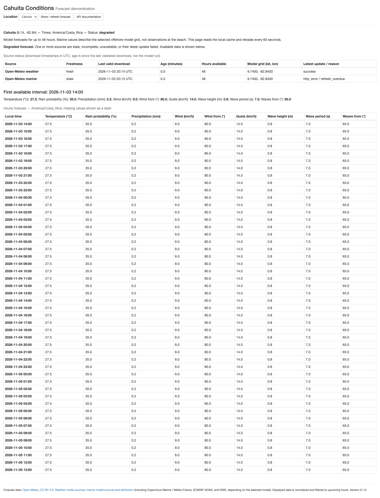
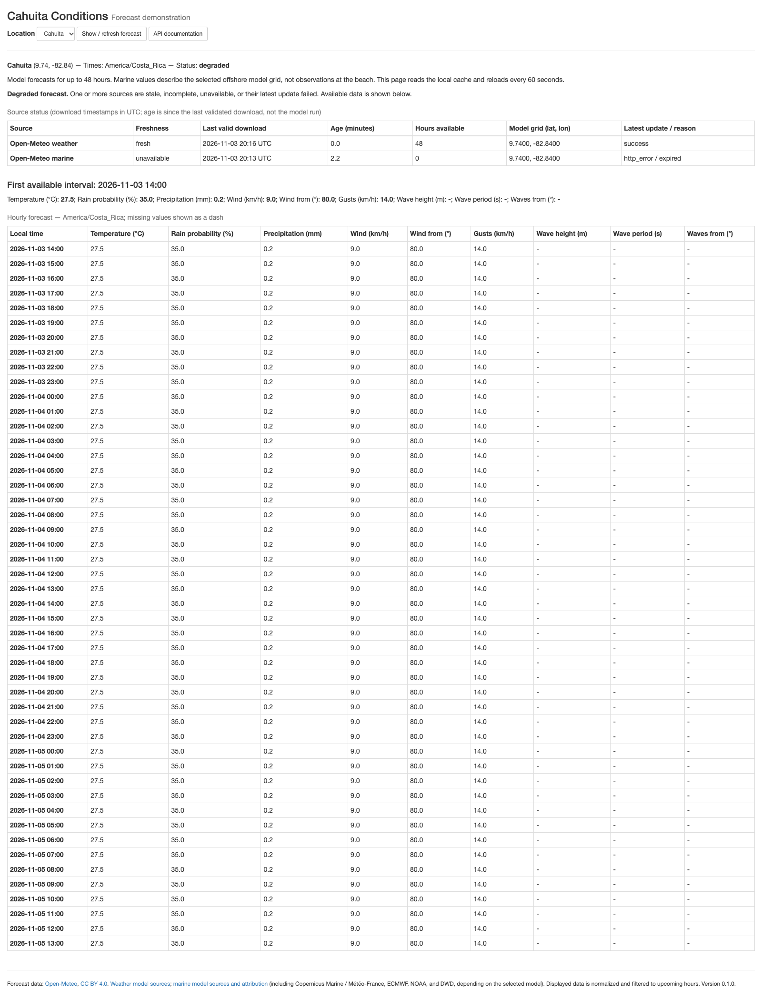
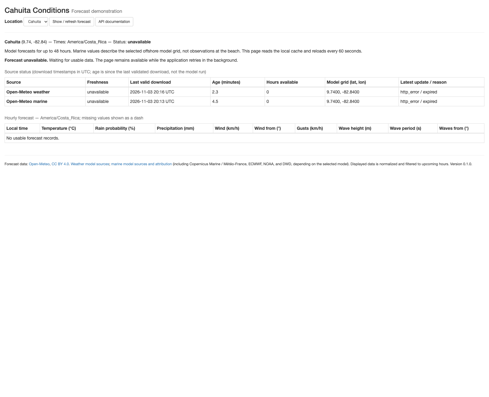
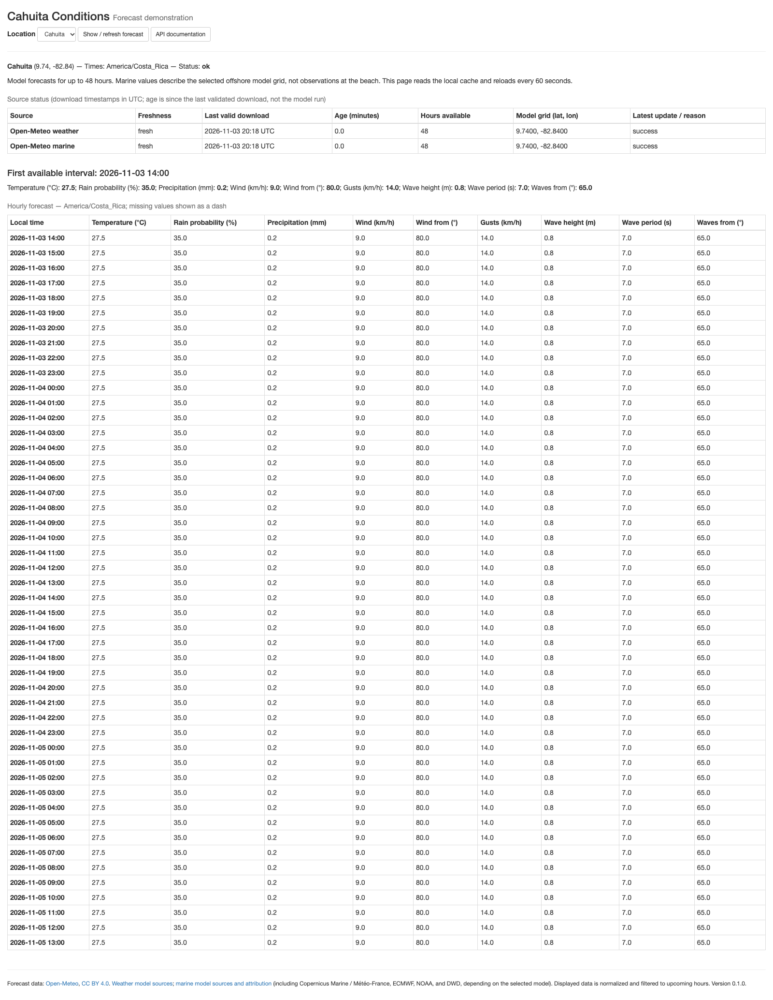
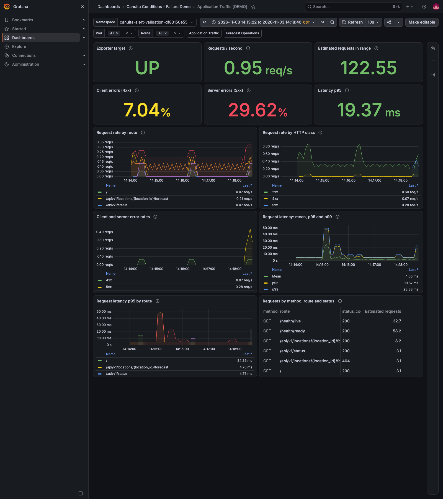
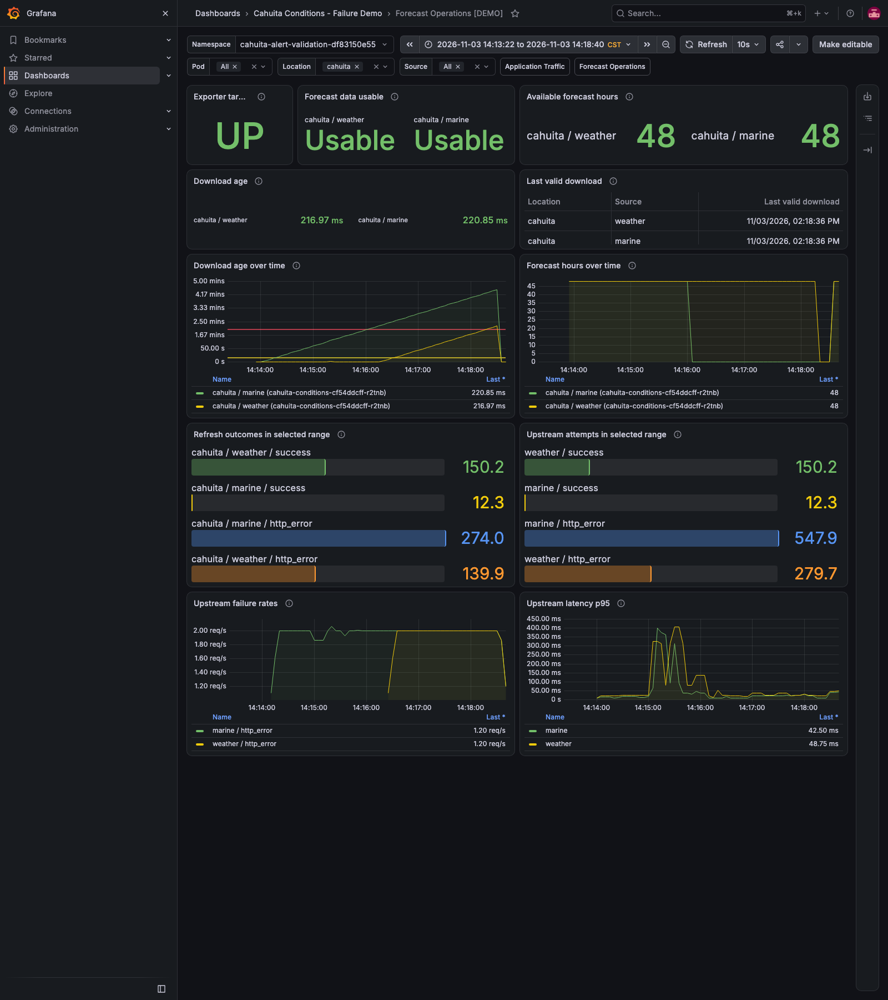
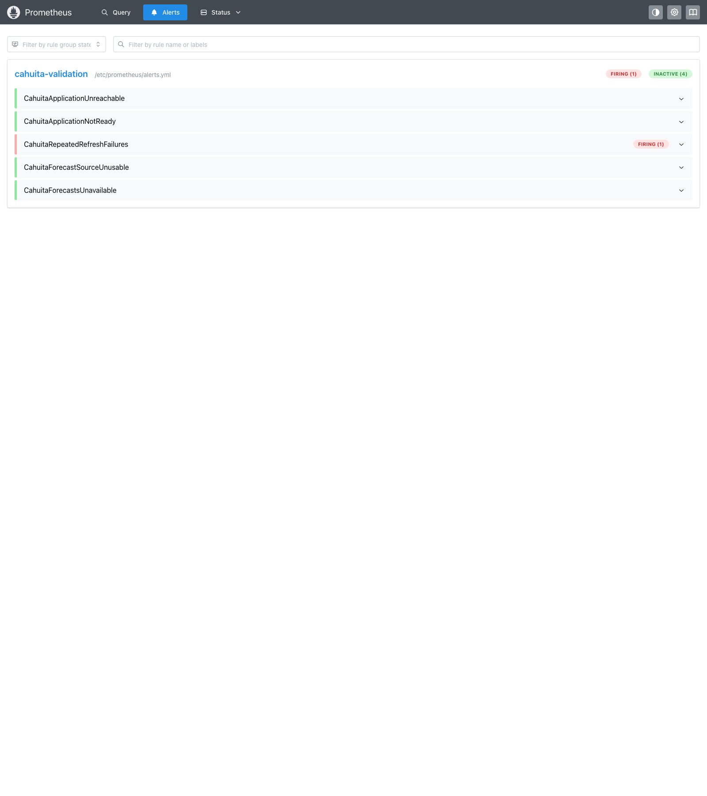
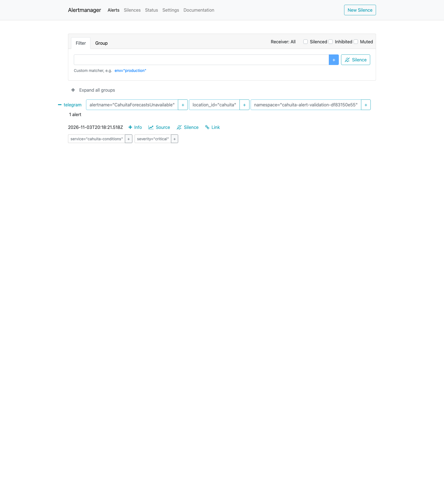
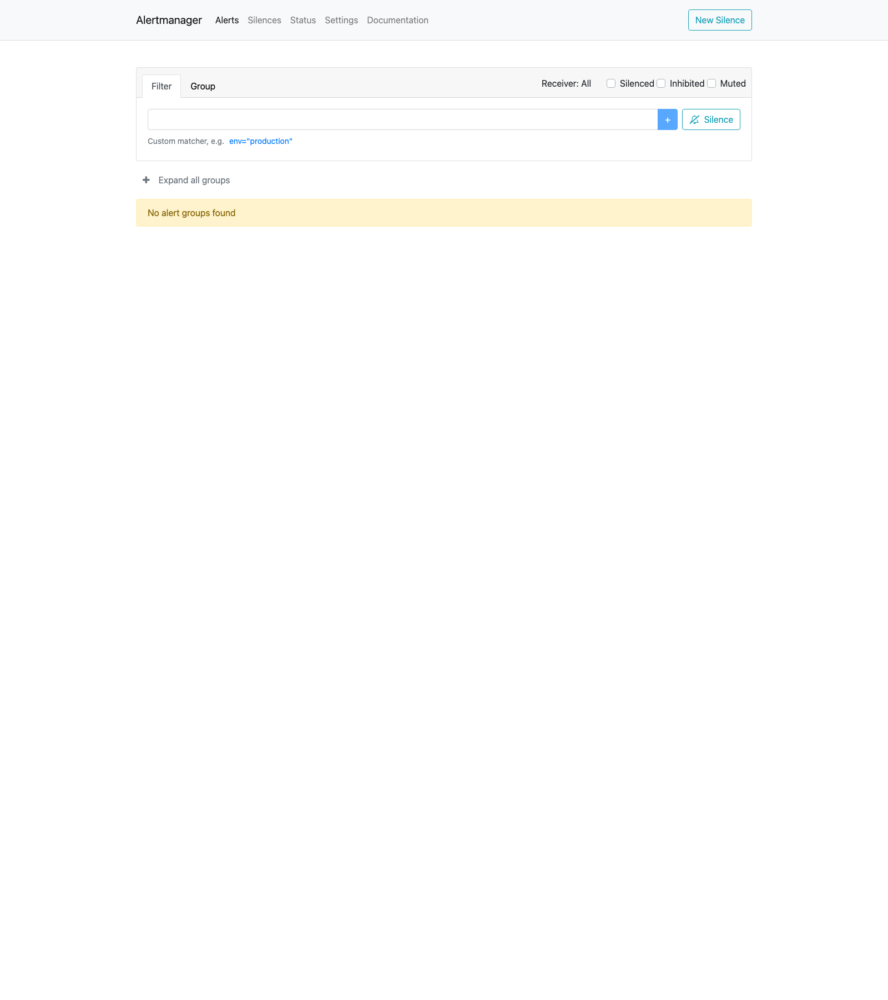
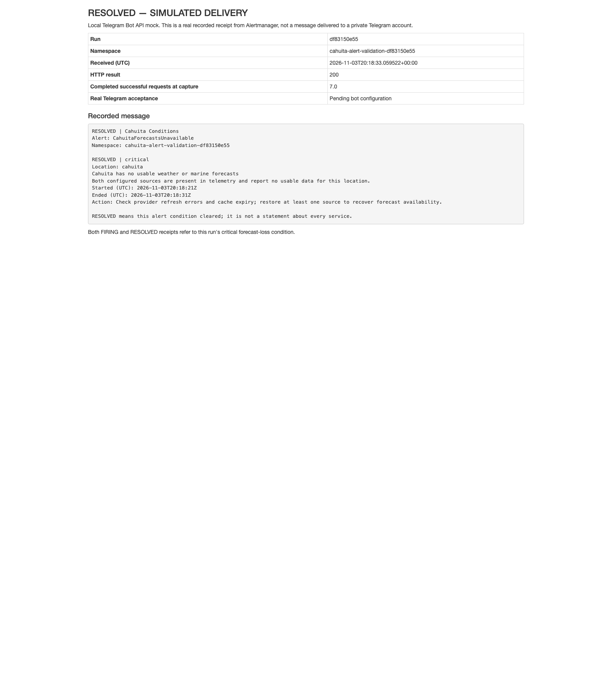

> **REFERENCE EVIDENCE:** These prior implementation captures are examples, not results from the recipient repository/account. Keep their original run metadata and generate your own acceptance evidence. Delivery shown below is simulated.

# Failure and recovery evidence

Run **df83150e55**, 2026-11-03 14:13 America/Costa_Rica.
Namespace: `cahuita-alert-validation-df83150e55`. All twelve captures below come from this same run.

**SIMULATED DELIVERY:** the notifications were sent by the isolated Alertmanager to a
local Telegram Bot API mock. Real private-chat delivery remains pending bot configuration.

The application, provider mock, Prometheus, Alertmanager, receiver and Grafana ran in one
temporary namespace. Provider URLs remained unchanged. Production workloads, images,
settings, dashboards and persistent volumes were preserved, and demo resources were removed.

## Observed stages

| Phase | API HTTP | Status | Ready HTTP | Weather h | Marine h | Marine age (s) | Firing alerts |
| --- | --- | --- | --- | --- | --- | --- | --- |
| healthy | 200 | ok | 200 | 48 | 48 | 0.0 | None |
| cached | 200 | degraded | 200 | 48 | 48 | 16.4 | CahuitaRepeatedRefreshFailures |
| partial | 200 | degraded | 200 | 48 | 0 | 131.8 | CahuitaForecastSourceUnusable, CahuitaRepeatedRefreshFailures |
| unavailable | 503 | unavailable | 503 | 0 | 0 | 268.3 | CahuitaApplicationNotReady, CahuitaForecastSourceUnusable, CahuitaForecastsUnavailable, CahuitaRepeatedRefreshFailures |
| recovered | 200 | ok | 200 | 48 | 48 | 0.7 | None |

The marine download remained `2026-11-03T20:13:57.297635Z` during cached failure,
while refresh attempts failed and its age grew. Weather remained usable through partial
availability. At total loss, forecasts/readiness returned 503 while liveness/metrics
continued and the exporter stayed UP. Both sources recovered and the critical condition
produced a correlated RESOLVED notification.

The table lists Prometheus firing conditions. Inhibited warnings remain FIRING there
while Alertmanager suppresses their delivery in favor of the critical condition.

Demo timings: refresh 1s, stale 15s, expiry 120s; scrape 5s, evaluation 1s, pending 5s.
These are demonstration settings, not changes to the real deployment's normal timings.
Grafana history captures use a fixed time range spanning this run. The application's
captures were taken with JavaScript disabled; Prometheus, Alertmanager and Grafana use
their actual web interfaces. Notification captures render recorded mock receipts.

## Capture catalog

### Healthy application

Run `df83150e55`; phase `healthy`; captured `2026-11-03T20:13:57.148996+00:00` (UTC).


### Marine failure with a usable cached forecast

Run `df83150e55`; phase `cached`; captured `2026-11-03T20:14:15.910051+00:00` (UTC).



### Partial availability after marine cache expiration

Run `df83150e55`; phase `partial`; captured `2026-11-03T20:16:11.972221+00:00` (UTC).



### Both sources unavailable; HTML controls remain available

Run `df83150e55`; phase `unavailable`; captured `2026-11-03T20:18:29.872830+00:00` (UTC).



### Recovered application

Run `df83150e55`; phase `recovered`; captured `2026-11-03T20:18:41.451564+00:00` (UTC).



### Traffic, errors and latency across the run

Run `df83150e55`; phase `recovered`; captured `2026-11-03T20:18:46.424442+00:00` (UTC).



### Refresh results, age and forecast hours across the run

Run `df83150e55`; phase `recovered`; captured `2026-11-03T20:18:49.099226+00:00` (UTC).



### Firing repeated-refresh warning in Prometheus

Run `df83150e55`; phase `cached`; captured `2026-11-03T20:14:16.444638+00:00` (UTC).



### Critical forecast-loss alert in Alertmanager

Run `df83150e55`; phase `unavailable`; captured `2026-11-03T20:18:30.140414+00:00` (UTC).



### Alertmanager after conditions cleared

Run `df83150e55`; phase `recovered`; captured `2026-11-03T20:18:41.674523+00:00` (UTC).



### Recorded FIRING receipt — SIMULATED DELIVERY

Run `df83150e55`; phase `unavailable`; captured `2026-11-03T20:18:30.324982+00:00` (UTC).


### Recorded RESOLVED receipt — SIMULATED DELIVERY

Run `df83150e55`; phase `recovered`; captured `2026-11-03T20:18:41.824456+00:00` (UTC).



## Reproduce

From the repository root, after the existing Kubernetes setup and Playwright installation:

```sh
python3 scripts/failure_demo.py run
python3 scripts/failure_demo.py publish-evidence --run-id <ID printed by run>
```

See [exact automatic and manual instructions](../../failure-recovery.md).
`manifest.json` records sanitized observations and SHA256 hashes for every PNG.
Full responses, queries and simulated message receipts remain in the ignored per-run artifacts.
